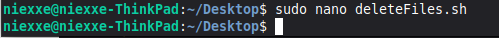
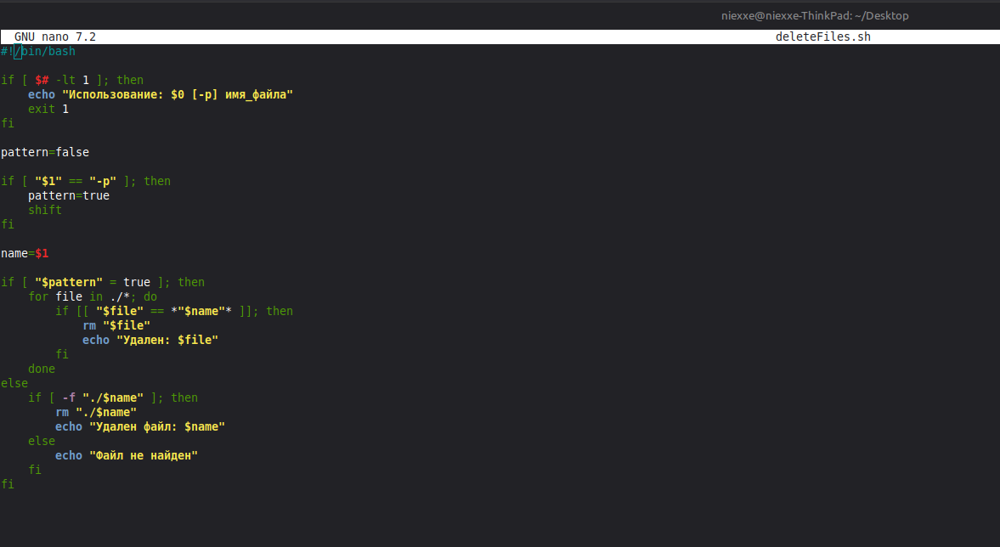
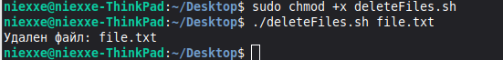
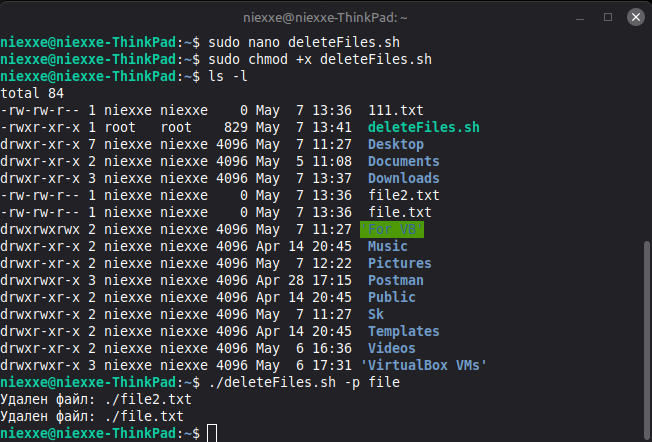

# Лабораторная работа №1. Linux: базовое взаимодействие

[← К списку лабораторных](../../README.md)

## Цель работы

Изучить основы работы с операционной системой Linux, освоить базовые команды и научиться писать простые bash-скрипты.

## Индивидуальное задание

Разработать bash-скрипт для удаления файлов по имени с возможностью использования шаблона (-p).

## Ход работы

В ходе лабораторной работы была изучена структура файловой системы Linux и основные команды CLI. После этого был реализован bash-скрипт для удаления файлов.  
  
Скрипт принимает аргументы командной строки. Если указан флаг -p, то выполняется удаление файлов по шаблону. В противном случае удаляется файл с точным именем.  
  
Также была реализована проверка корректности ввода параметров.

## Скриншоты выполнения



**Рис. 1.** создание deleteFiles.sh



**Рис. 2.** Скрипт




**Рис.3.** проверка скрипта



**Рис. 4.** Проверка удаления по шаблону

## Исходный код программы

```bash
#!/bin/bash

if [ $# -lt 1 ]; then
    echo "Использование: $0 [-p] имя_файла"
    exit 1
fi

pattern=false

if [ "$1" == "-p" ]; then
    pattern=true
    shift
fi

name=$1

if [ "$pattern" = true ]; then
    for file in ./*; do
        if [[ "$file" == *"$name"* ]]; then
            rm "$file"
            echo "Удален: $file"
        fi
    done
else
    if [ -f "./$name" ]; then
        rm "./$name"
        echo "Удален файл: $name"
    else
        echo "Файл не найден"
    fi
fi
```

## Заключение

В ходе выполнения лабораторной работы были изучены базовые команды Linux, а также получены навыки написания bash-скриптов. Реализованный скрипт позволяет удалять файлы как по точному имени, так и по шаблону.

## Контрольные вопросы

1\. Linux — это операционная система с открытым исходным кодом.  
2. Переменные окружения доступны всем процессам, а переменные оболочки — только внутри текущей оболочки.  
3. С помощью какой команды изменяются права доступа к файлу?  
Права доступа к файлу изменяются с помощью команды chmod. Она позволяет добавлять, удалять или задавать права на чтение, запись и выполнение для владельца, группы и остальных пользователей. В методичке приведены примеры chmod g+r file, chmod o+r file, chmod go+r file, а также абсолютный вариант chmod 644 file

Примеры:

chmod +x script.sh — делает фаил исполняемым

chmod 644 file.txt —задаёт владельцу права на чтение и запись, а группе и остальным — только чтение.

chmod 755 program.sh— задаёт владельцу полные права, а группе и остальным — чтение и выполнение.