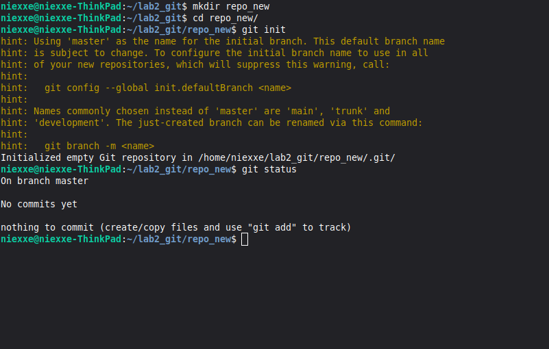
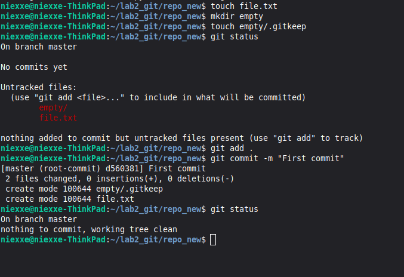
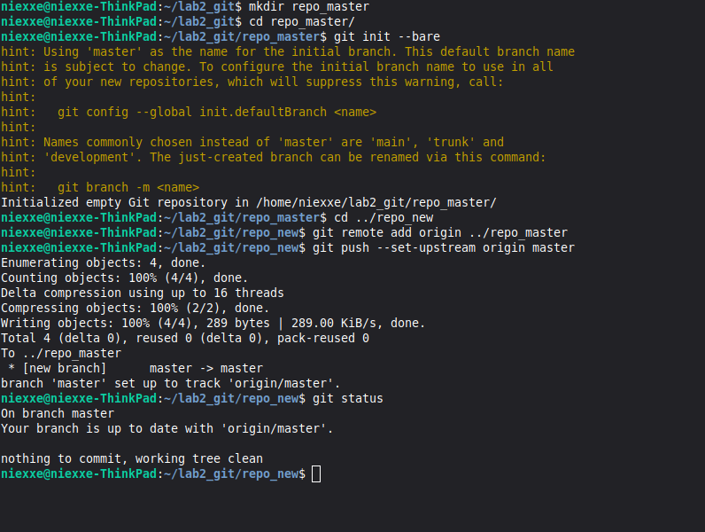
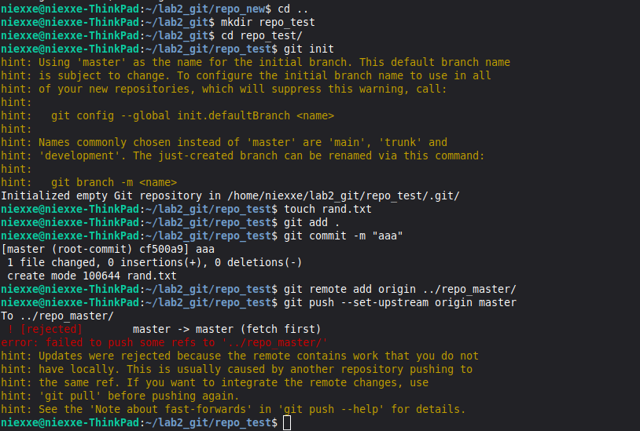
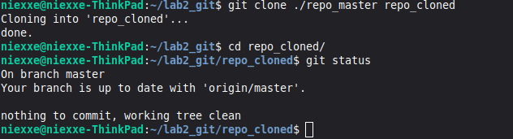
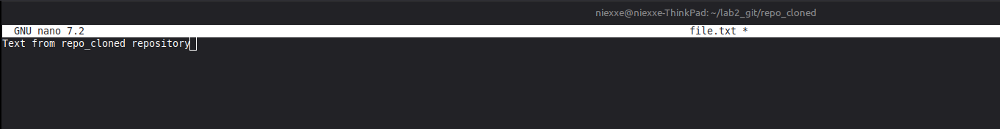
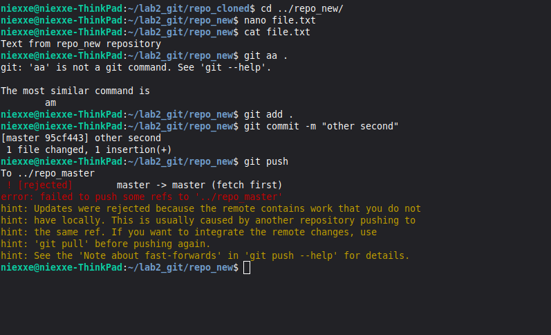
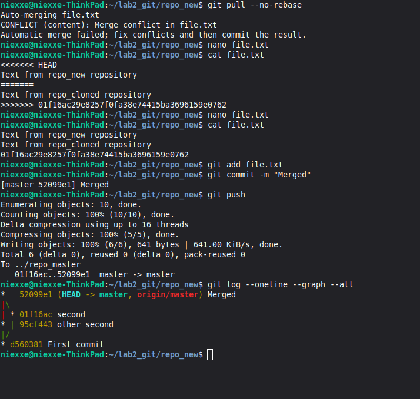

# Лабораторная работа №2. Основы Git

[← К списку лабораторных](../../README.md)

## Цель работы

Изучить основы системы контроля версий Git, освоить базовые команды и научиться работать с репозиториями.

## Ход работы

В ходе лабораторной работы был установлен Git и выполнена его базовая настройка. После этого был создан локальный репозиторий с помощью команды git init.  
  
Далее были созданы файлы и выполнен первый коммит. Для этого использовались команды git add и git commit. Был изучен процесс отслеживания файлов и состояние репозитория.  
  
Затем был создан удалённый (master) репозиторий с использованием режима bare. Локальный репозиторий был связан с удалённым с помощью git remote add, после чего изменения были отправлены с помощью git push.  
  
Также была рассмотрена ситуация с несовпадением root-коммитов, в результате чего возникла ошибка при попытке отправки изменений. Данная ошибка показала важность согласованности истории репозитория.  
  
После этого был выполнен процесс клонирования репозитория с помощью команды git clone. В клонированном репозитории были внесены изменения и отправлены в удалённый репозиторий.  
  
В исходном репозитории были выполнены изменения того же файла, что привело к конфликту версий. Конфликт был успешно разрешён вручную путём редактирования файла и удаления служебных меток конфликта. После этого изменения были зафиксированы и отправлены в удалённый репозиторий.

# Основные команды

**git init –** создание репозитория**  
git status –** просмотр состояния**  
git add –** добавление файлов в индекс**  
git commit –** фиксация изменений**  
git remote add –** добавление удалённого репозитория**  
git push –** отправка изменений**  
git clone –** клонирование репозитория**  
git pull –** получение изменений**  
git log –** просмотр истории коммитов

## Скриншоты выполнения

Рис. 1. Создание первого репозитория

Рис. 2. Первый commit

**Рис. 3.** Создание master репозитория

**Рис. 4.** Провека ошибки с другими root-commit

**Рис. 5.** Клонирование

**Рис. 6.** Изменение в клоне(file.txt)

**Рис. 7.** Конфликт в repo_new

**Рис. 8.** Решение конфликта

## Ссылка на репозиторий

https://gitlab.com/Niexxe/lab2_git/-/tree/master?ref_type=heads

## Заключение

В ходе выполнения лабораторной работы были получены практические навыки работы с системой контроля версий Git. Были изучены основные команды, а также рассмотрены процессы клонирования, синхронизации и разрешения конфликтов.

# **Контрольные вопросы**

1\. Git — это распределённая система контроля версий.  
2. Ветка — это указатель на коммит, позволяющий вести параллельную разработку.  
3. Fast-forward — это слияние без создания нового коммита, когда история линейна.  
4. Merge — это объединение веток с возможным созданием нового коммита и разрешением конфликтов.