# Лабораторная работа №3. Основы Docker

[← К списку лабораторных](../../README.md)

## Цель работы

Изучить основы работы с Docker, освоить базовые команды Docker CLI, научиться запускать и инспектировать контейнеры, просматривать логи приложений, а также создавать Docker-образы с помощью Dockerfile для приложений на Python и Java.

## Ход работы

В ходе лабораторной работы был установлен Docker и дополнительная утилита jq для обработки JSON.  
  
Далее был запущен контейнер nginx с тегом alpine3.20 в фоновом режиме с пробросом порта 8000. После запуска была проверена работоспособность контейнера через браузер по адресу localhost:8000.  
  
Были изучены логи контейнера с помощью команды docker logs, а также выполнено инспектирование контейнера. С помощью jq были получены данные о времени создания контейнера и его IP-адресе. Версия nginx была определена через выполнение команды внутри контейнера.  
  
После этого был создан Dockerfile для Python-приложения. Образ был успешно собран и запущен.  
  
Далее было реализовано Java-приложение. Сначала был создан образ без использования multi-stage сборки, после чего был создан второй вариант с использованием multi-stage. Было проведено сравнение размеров образов, которое показало, что multi-stage сборка позволяет значительно уменьшить размер итогового образа.

## Скриншоты выполнения

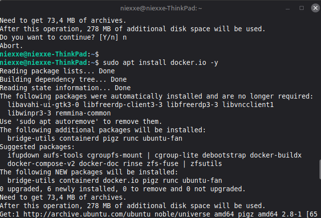

Рис. 1. Установка docker

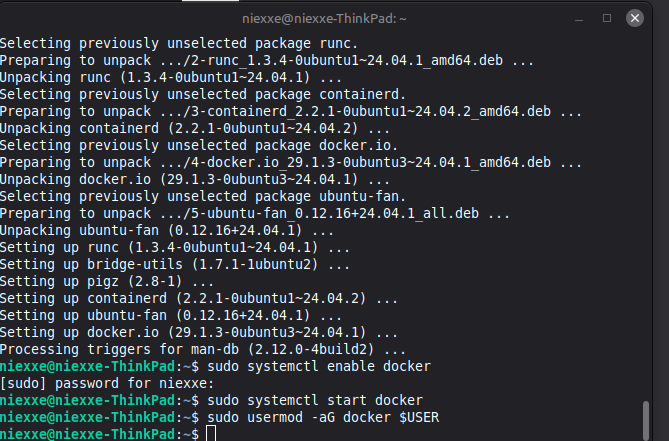

Рис. 2. Запуск службы

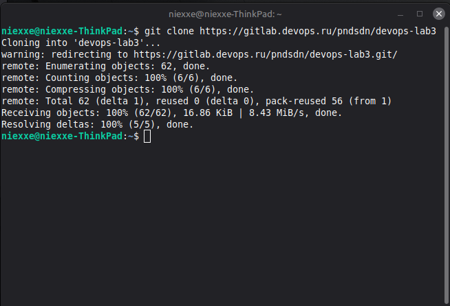

Рис. 3. Клонирование репозитория

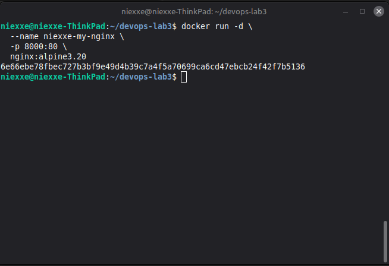

Рис. 4. Запуск нового контейнера nginx

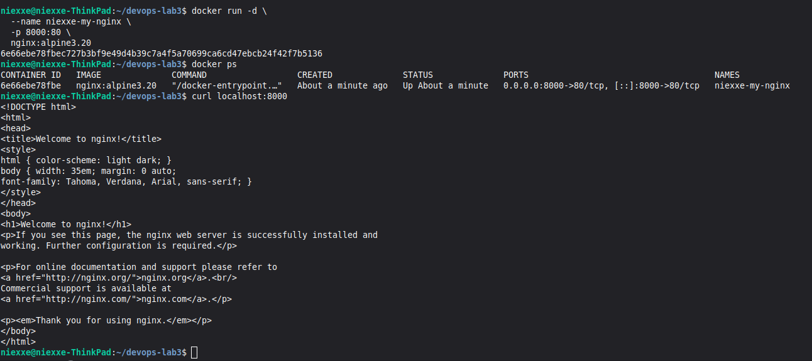

**Рис. 5.** Проверка nginx

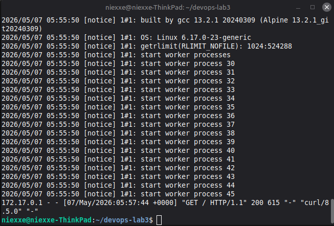

Рис. 6. Просмотр логов

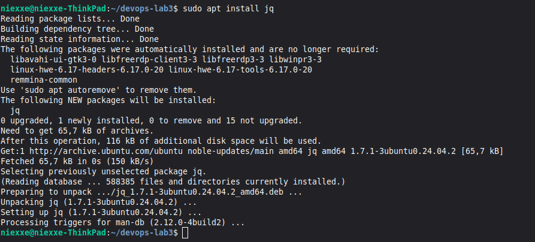

Рис. 7. Установка jq

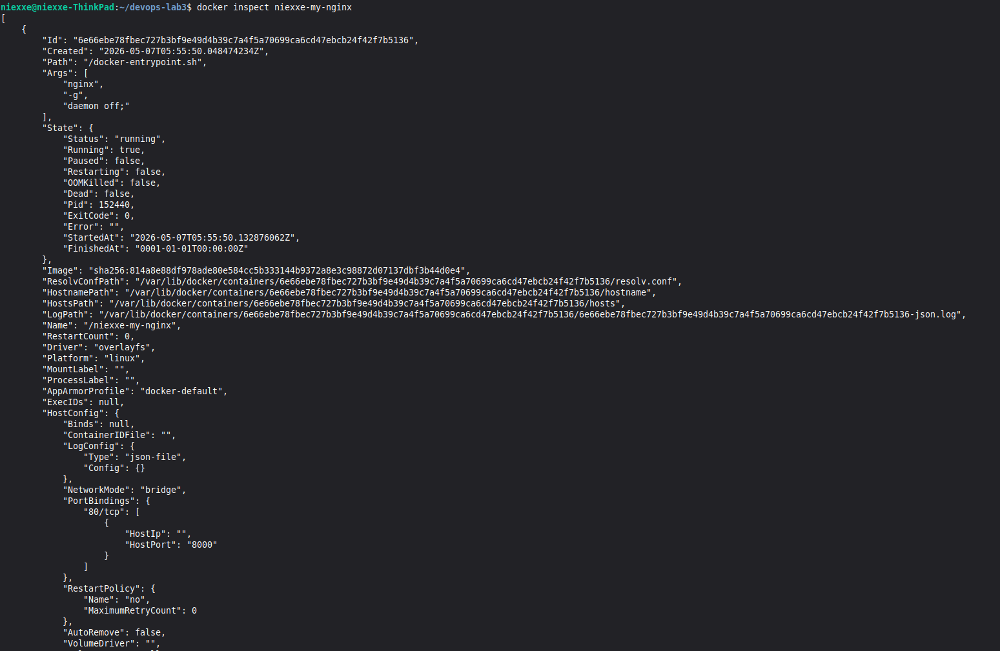

Рис. 8. Инспектирование контейнера

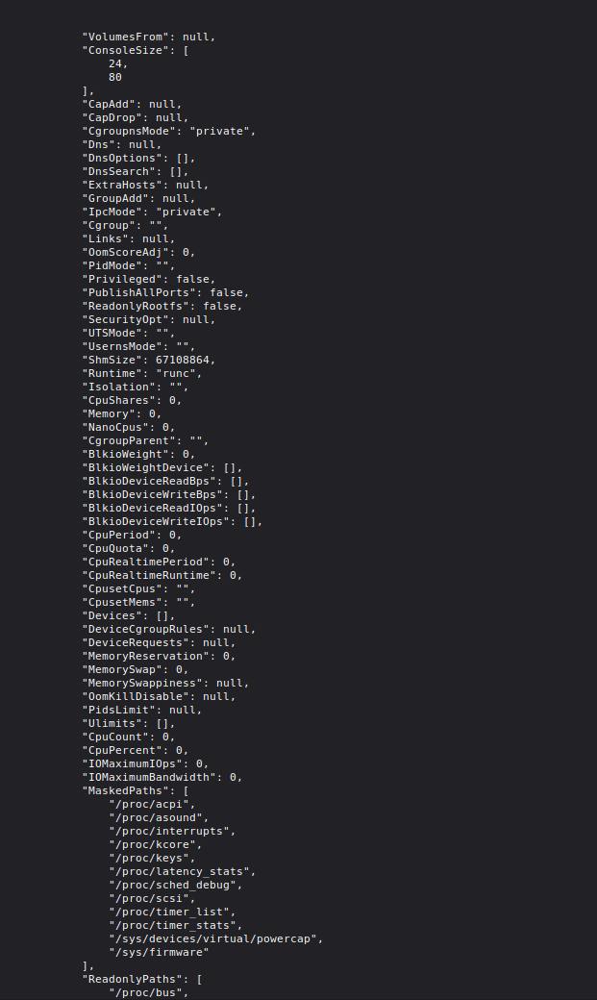

Рис. 9. Инспектирование контейнера ч. 2

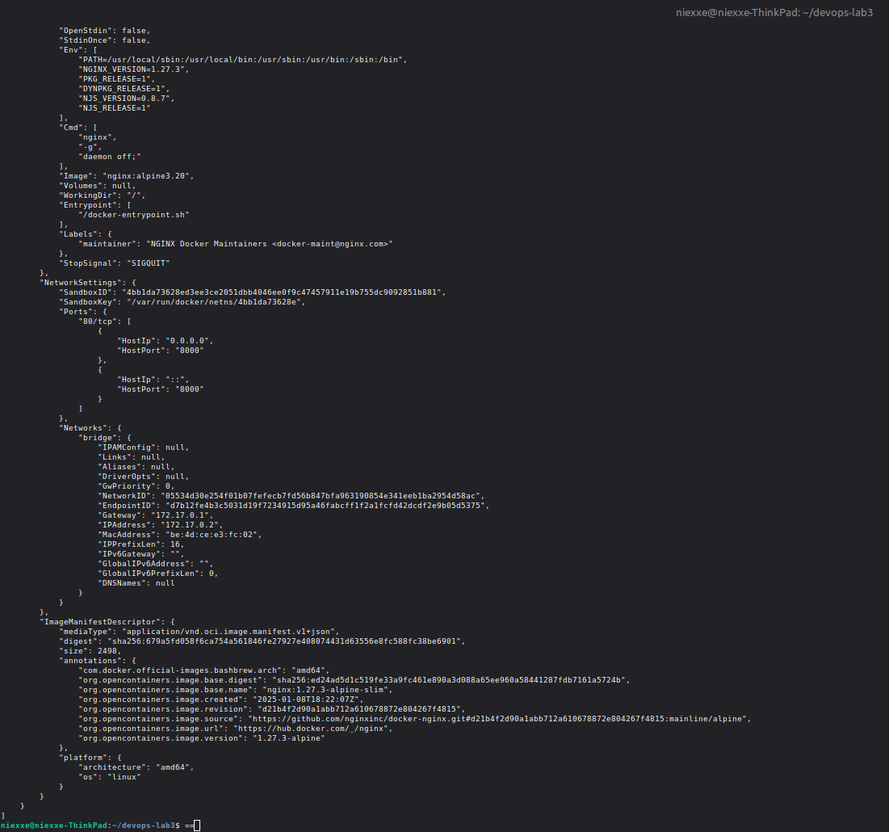

Рис. 10. Инспектирование контейнера ч. 3

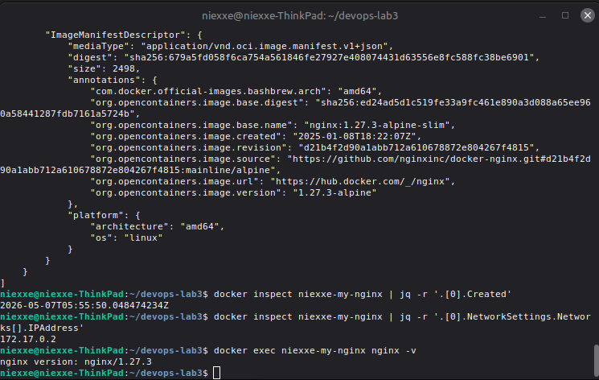

Рис. 11. Время создания, ip адресс(контейнера), версия nginx

Python-приложение

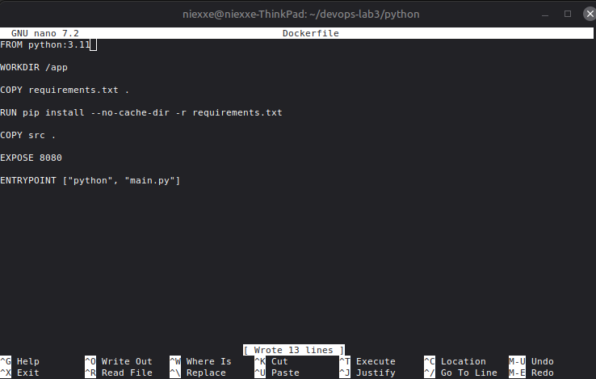

Рис. 12. Создание Dockerfile в папке python

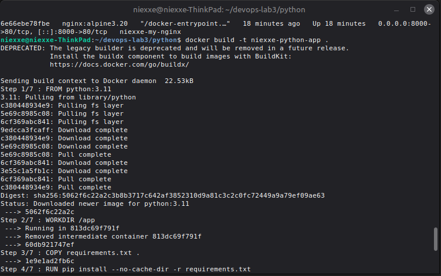

Рис. 13. Сборка

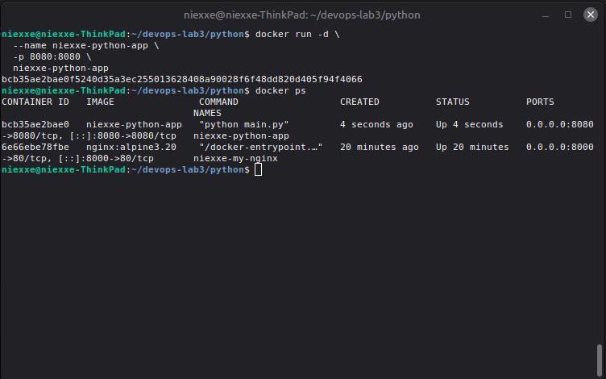

Рис. 14. Запуск и проверка

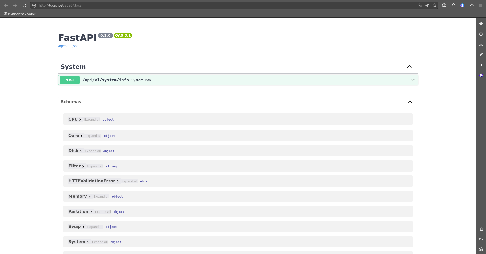

Рис. 15. Запуск Swagger

Java приложение

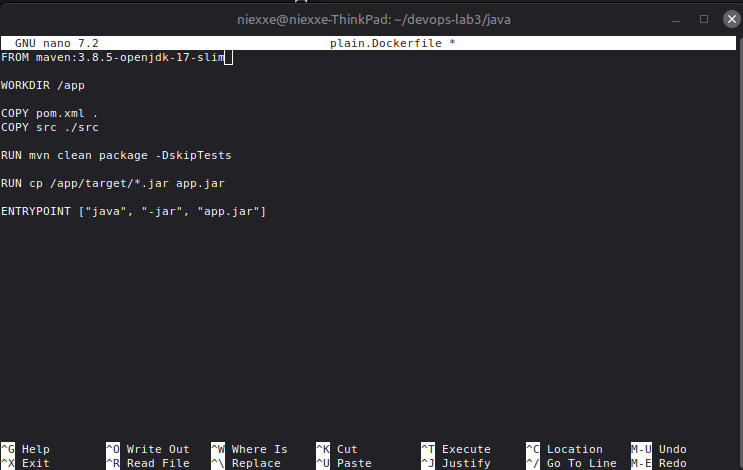

Рис. 16. Содержимое PlainDockerfile

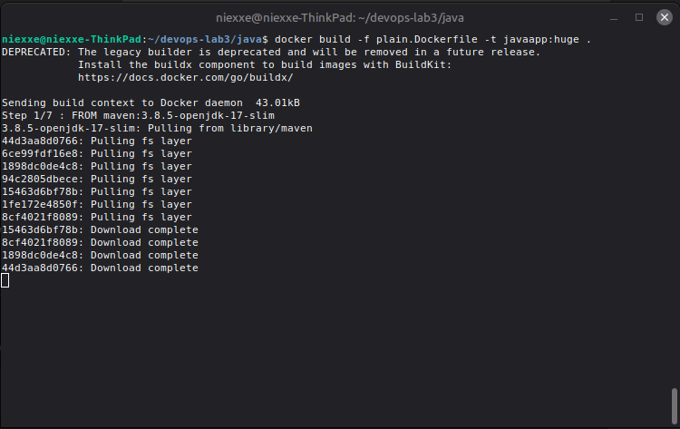

Рис. 17. Сборка образа

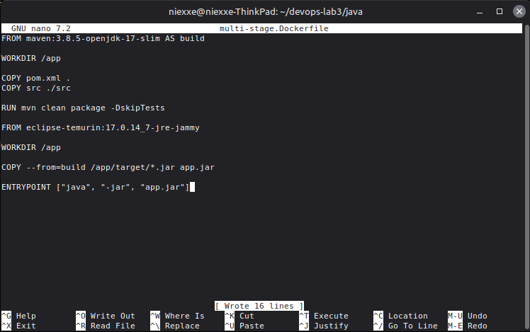

Рис. 18. Содержимое multi-stage Dockerfile

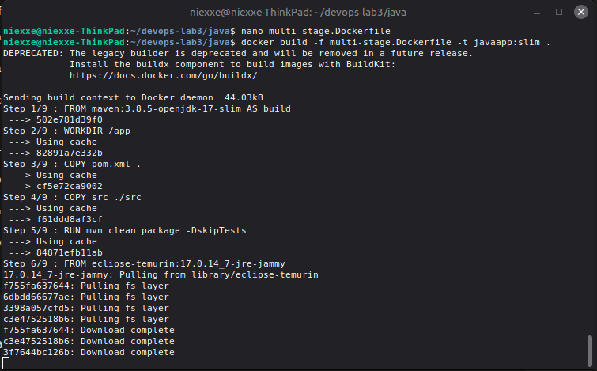

Рис. 19. Сборка образа

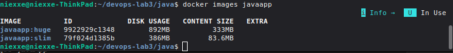

Рис. 20. Сравнение размеров образов

## Ссылка на репозиторий

**https://gitlab.com/Niexxe/lab3_docker**

## Заключение

В ходе лабораторной работы были изучены основы контейнеризации с использованием Docker. Были освоены основные команды Docker CLI, выполнен запуск контейнера nginx, просмотр логов и инспектирование контейнера с помощью docker inspect и jq. Также были созданы Dockerfile для Python- и Java-приложений. Дополнительно была изучена технология multi-stage сборки, позволяющая существенно уменьшить размер итогового Docker-образа.

## Ответы на контрольные вопросы

### 1. Что такое Docker?

Docker — это платформа контейнеризации, предназначенная для разработки, доставки и запуска приложений в контейнерах.

### 2. Что такое образ?

Образ (image) — это шаблон, содержащий приложение, зависимости и необходимые настройки, на основе которого создаются контейнеры.

### 3. Что такое контейнер?

Контейнер — это запущенный экземпляр Docker-образа, представляющий собой изолированную среду выполнения приложения.

### 4. Причина ошибки при запуске контейнера

Ошибка возникает из-за неправильного использования инструкций ENTRYPOINT и CMD в shell-режиме. При передаче аргументов Docker пытается объединить команды некорректным образом, из-за чего формируется неверная команда запуска.

Для устранения ошибки необходимо использовать exec-форму инструкций:

```dockerfile
ENTRYPOINT ["python"]
CMD ["main.py"]
```

Или:

```dockerfile
ENTRYPOINT ["python", "main.py"]
```

Такой способ обеспечивает корректную передачу аргументов и правильную обработку сигналов внутри контейнера.