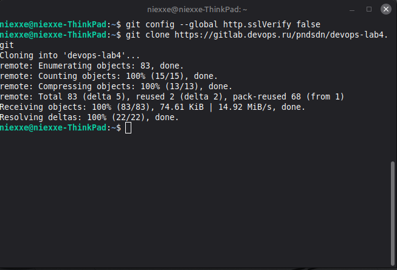
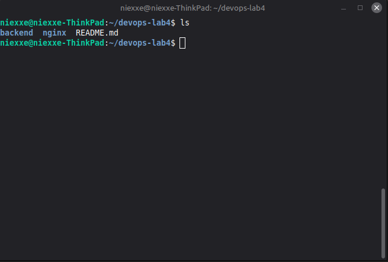
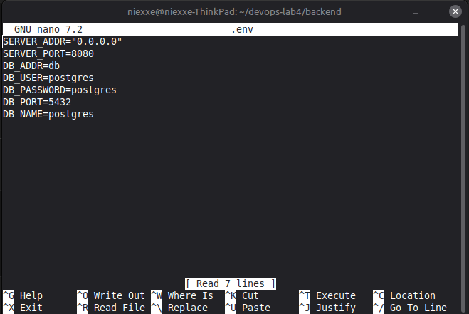
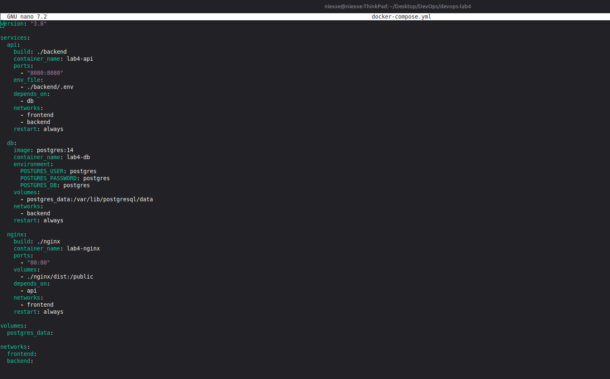
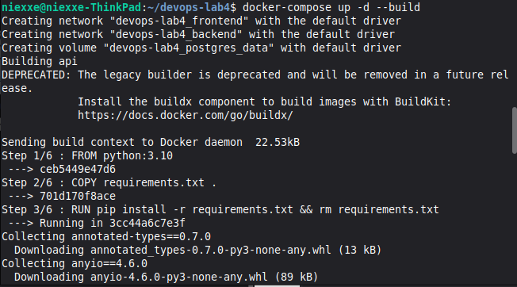
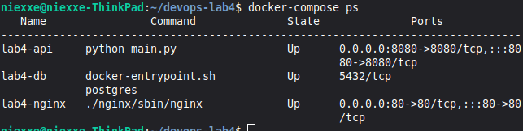
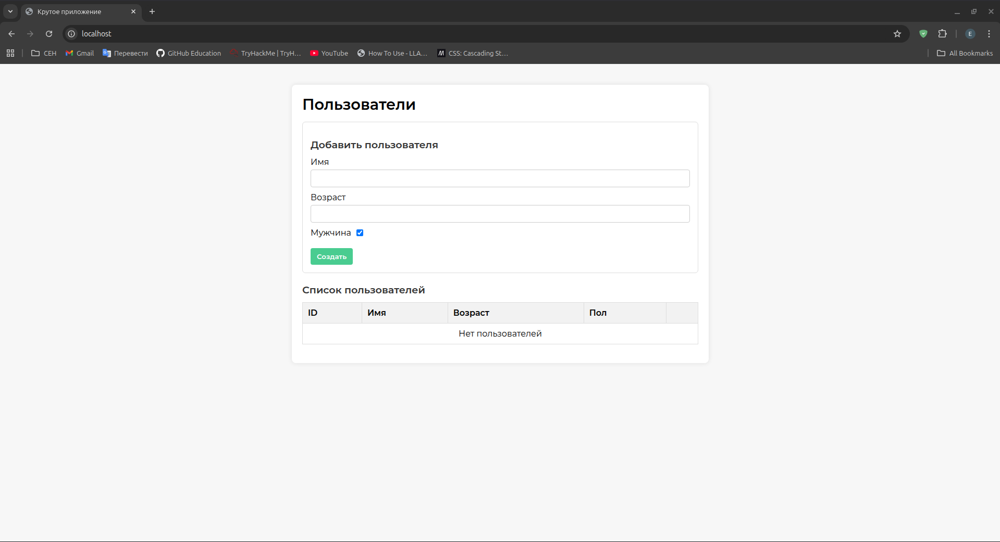

# Лабораторная работа №4. Docker Compose

[← К списку лабораторных](../../README.md)

## Цель работы

Изучить технологию Docker Compose, освоить описание и запуск многоконтейнерных приложений.

## Ход работы

В ходе работы был создан docker-compose.yml с тремя сервисами: api, db и nginx. Сервисы были связаны через сети frontend и backend, а также настроены тома и переменные окружения. После сборки и запуска контейнеров была проверена их работоспособность.

## Скриншоты выполнения



Рис. 1. Клонирование репозитория



Рис. 2. Проверка структуры



Рис. 3. Настройка .env



Рис. 4. docker-compose.yml



Рис. 5. Запуск



Рис. 6. Проверка



Рис. 7. Проверка в браузере

## Ссылка на репозиторий

https://gitlab.com/Niexxe/lab4_Docker_Compose

## Заключение

Были получены навыки работы с Docker Compose, настройкой сервисов, сетей и томов.

## Контрольные вопросы

**1. Что такое Docker Compose и для чего он используется?**  
Docker Compose — это инструмент для описания и запуска многоконтейнерных приложений. Он позволяет в одном docker-compose.yml настроить сервисы, сети, тома, переменные окружения и запустить всё одной командой docker compose up.

**2. Почему возникает ошибка с** postgres_data **и как её исправить?**  
Ошибка возникает потому, что postgres_data:/var/lib/postgresql/data воспринимается как **именованный том**, но он не объявлен в верхнем разделе volumes. Нужно объявить том:

```yaml
services:
  db:
    image: postgres:14.5
    restart: always
    environment:
      - POSTGRES_USER=postgres
      - POSTGRES_DB=postgres
      - POSTGRES_PASSWORD=postgres
    volumes:
      - postgres_data:/var/lib/postgresql/data

volumes:
  postgres_data:
```

Либо, если требуется использовать папку из текущей директории проекта, нужно указать bind mount через относительный путь:

```yaml
volumes:
  - ./postgres_data:/var/lib/postgresql/data
```

Тогда Docker будет использовать каталог postgres_data на хост-машине, а ошибка исчезнет.