# Лабораторная работа №5. Методология CI/CD

[← К списку лабораторных](../../README.md)

## Цель работы

Изучить принципы CI/CD и понять, как автоматизация помогает контролировать качество проекта на разных этапах разработки;

Освоить настройку GitHub Actions для автоматического запуска тестов и публикации Docker-образа.

## Индивидуальное задание

Разобрать теоретические материалы лабораторной работы;

Реализовать набор тестов для Python-приложения;

Настроить CI/CD-процесс, который выполняет тестирование, собирает Docker-образ и отправляет его в Docker Hub.

## Ход работы

### 4.1 Подготовка окружения и репозитория

На первом этапе был подготовлен отдельный репозиторий GitHub для выполнения лабораторной работы. Он использовался как удалённое хранилище, куда в дальнейшем отправлялись все изменения из локального проекта.

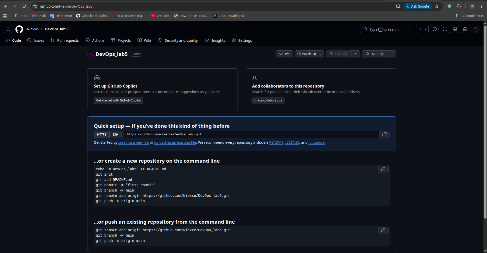


*Рисунок 1 – Созданный GitHub-репозиторий DevOps_lab5*

После получения исходного проекта была проверена его структура. В каталоге находились исходные файлы FastAPI-приложения, Dockerfile, каталог tests, файл зависимостей requirements.txt, а также директория .github/workflows, предназначенная для workflow-файлов GitHub Actions.

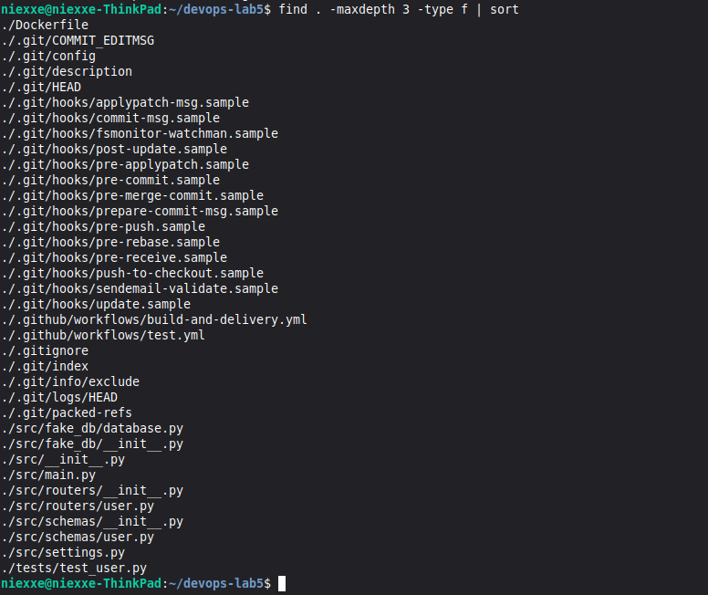


*Рисунок 2 – Проверка структуры проекта после клонирования*

### 4.2 Покрытие приложения тестами

Далее была изучена работа пользовательских маршрутов приложения. В файле src/routers/user.py описаны обработчики для поиска пользователя по e-mail, создания новой записи и удаления пользователя. На основе этой логики были дописаны тесты в tests/test_user.py.

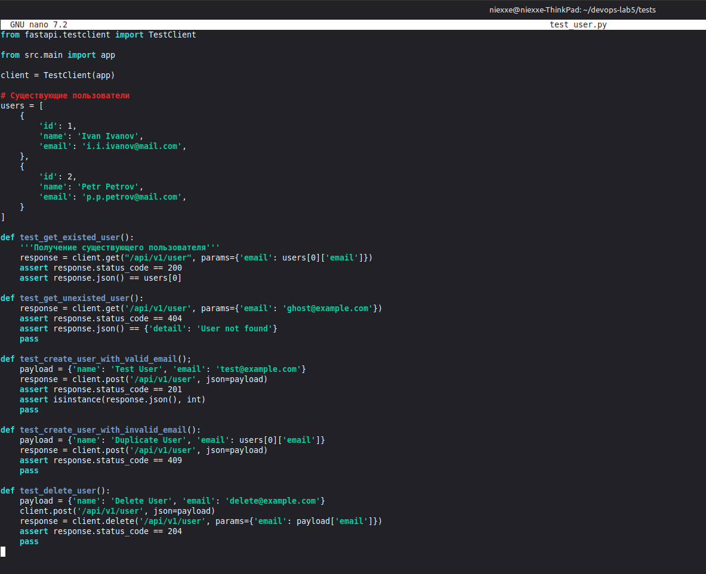


*Рисунок 3 – Файл tests/test_user.py с тестами для API пользователей*

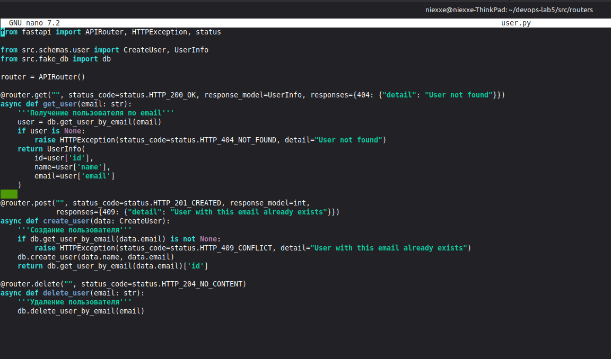


*Рисунок 4 – Просмотр маршрутов приложения в файле src/routers/user.py*

Для проверки проекта локально было создано виртуальное окружение Python. После активации окружения был обновлён pip и установлены зависимости приложения, включая FastAPI, pytest, httpx и pydantic-settings, необходимые для запуска тестов..

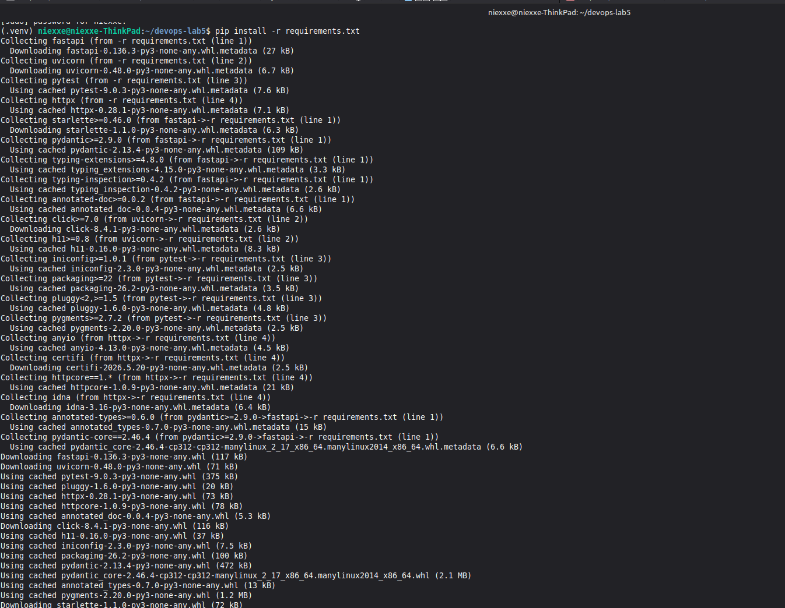


*Рисунок 5 – Создание виртуального окружения и установка зависимостей*

После установки зависимостей был выполнен запуск pytest. Все подготовленные проверки завершились успешно, что подтвердило корректную работу реализованных тестов и основных API-маршрутов.

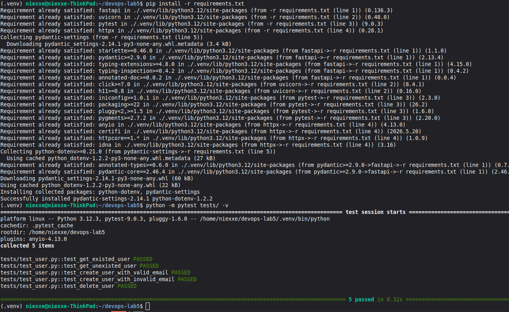


*Рисунок 6 – Успешный запуск тестов через pytest*

### 4.3 Настройка Dockerfile и GitHub Actions

Затем были проверены файлы, отвечающие за контейнеризацию и автоматическую проверку проекта. Dockerfile описывает сборку образа приложения, а workflow tests.yml запускает установку зависимостей и выполнение тестов при отправке изменений в репозиторий.

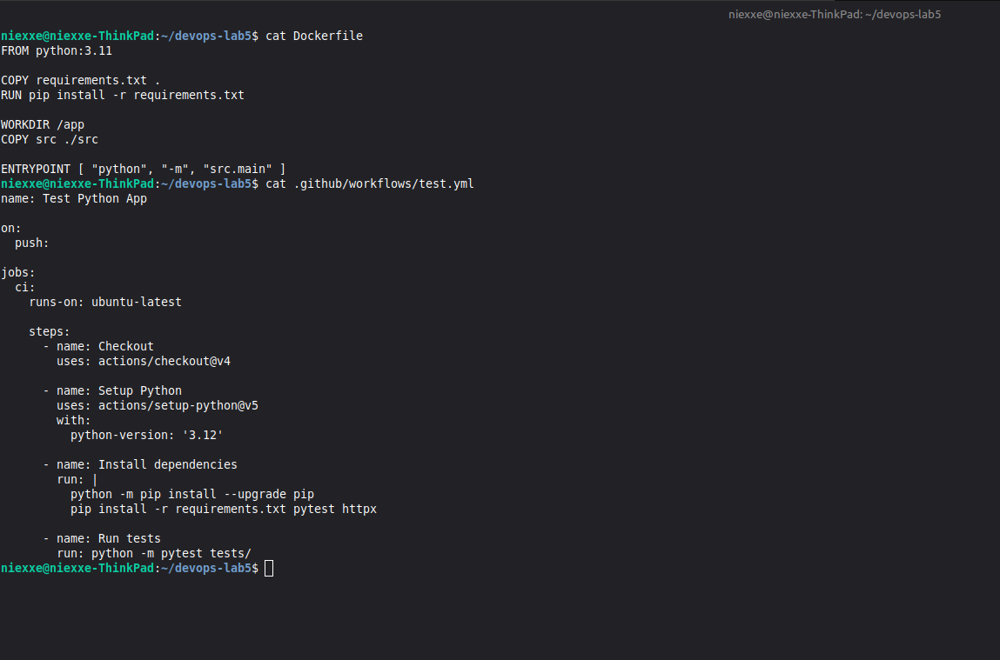


*Рисунок 7 – Dockerfile и workflow-файл tests.yml*

После подготовки тестов и workflow-файлов изменения были зафиксированы в Git. Для первичной проверки пайплайна коммиты были отправлены в ветку dev удалённого репозитория.

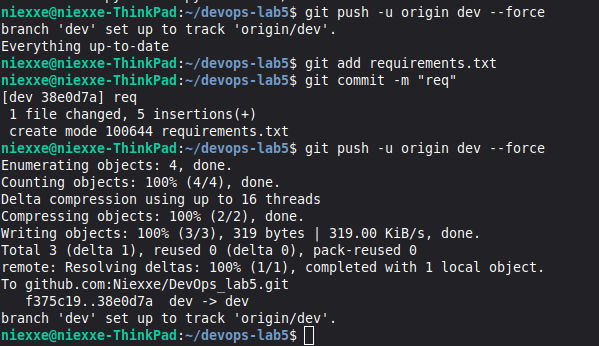


*Рисунок 8 – Отправка изменений в ветку dev*

После push в ветку dev на GitHub автоматически запустился процесс Test Python App. В результате все шаги workflow завершились успешно: репозиторий был загружен на runner, Python был настроен, зависимости установлены, а тесты выполнены без ошибок.

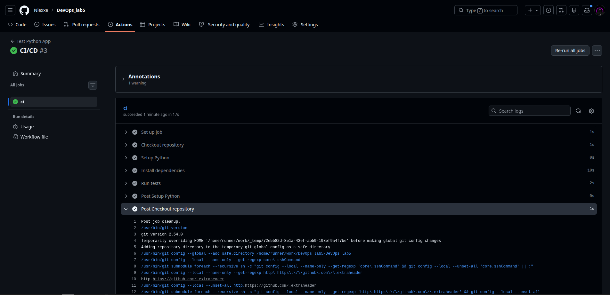

*Рисунок 9 – Успешное выполнение workflow Test Python App*

### 4.4 Создание переменных и секретов для публикации образа

Для публикации Docker-образа была настроена авторизация в Docker Hub. В качестве чувствительного значения использовался секрет DOCKERHUB_TOKEN, который не хранится в открытом виде в репозитории и подставляется только во время выполнения workflow.

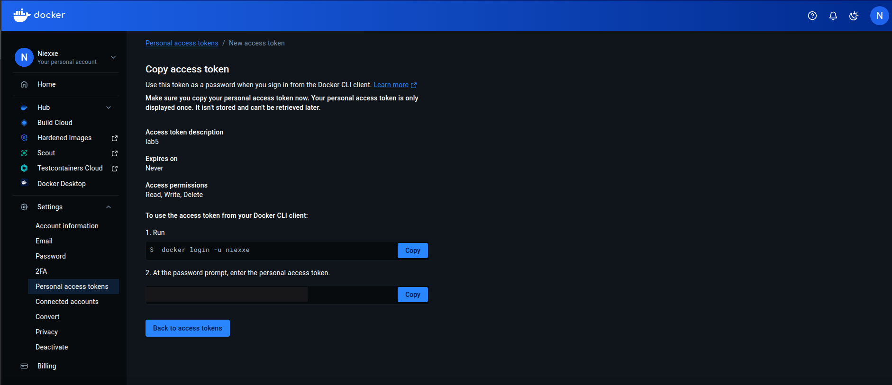


*Рисунок 10 – Создание персонального токена доступа в Docker Hub*

В настройках GitHub Actions была добавлена переменная DOCKERHUB_USERNAME со значением имени пользователя Docker Hub и секрет DOCKERHUB_TOKEN со значением пароля или access token. Эти значения используются в workflow build-and-delivery.yml для входа в Docker Hub.

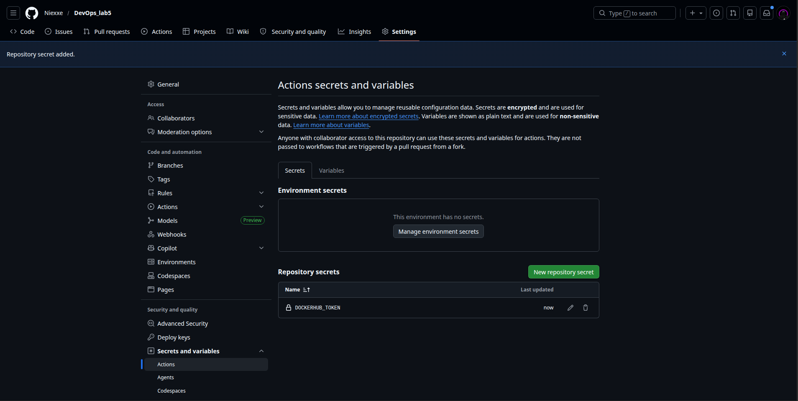


*Рисунок 11 – Добавление секрета DOCKERHUB_TOKEN в GitHub Actions*

### 4.5 Проверка пайплайна и Docker-образа

После успешной проверки в ветке dev изменения были перенесены в ветку main и отправлены в удалённый репозиторий. Именно для ветки main настроен запуск workflow Build and Delivery после успешного завершения Test Python App.

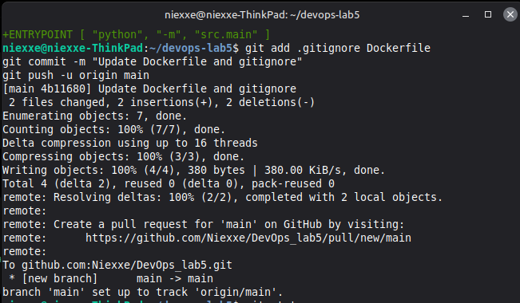

*Рисунок 12 – Отправка изменений в ветку main*

После прохождения тестового workflow в ветке main автоматически запустился процесс Build and Delivery. В ходе его выполнения GitHub Actions выполнил авторизацию в Docker Hub, собрал Docker-образ приложения и опубликовал его с тегом latest.

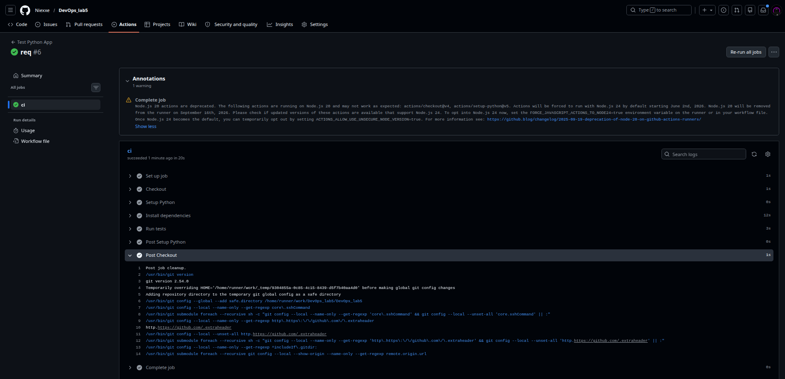

*Рисунок 13 – Успешное выполнение workflow Build and Delivery*

Для финальной проверки был загружен опубликованный Docker-образ niexxe/my-app:latest и запущен контейнер с пробросом порта 8080. Команда docker ps показала, что контейнер находится в состоянии Up, а запрос к /docs вернул HTML-страницу Swagger UI.

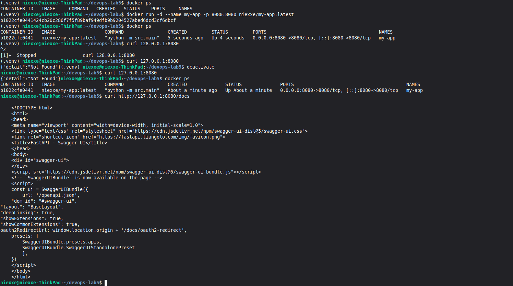

*Рисунок 14 – Запуск контейнера и проверка Swagger UI через curl*

Завершающая проверка была выполнена в браузере. Страница Swagger UI открылась по адресу http://127.0.0.1:8080/docs, что подтвердило успешный запуск приложения из Docker-образа.

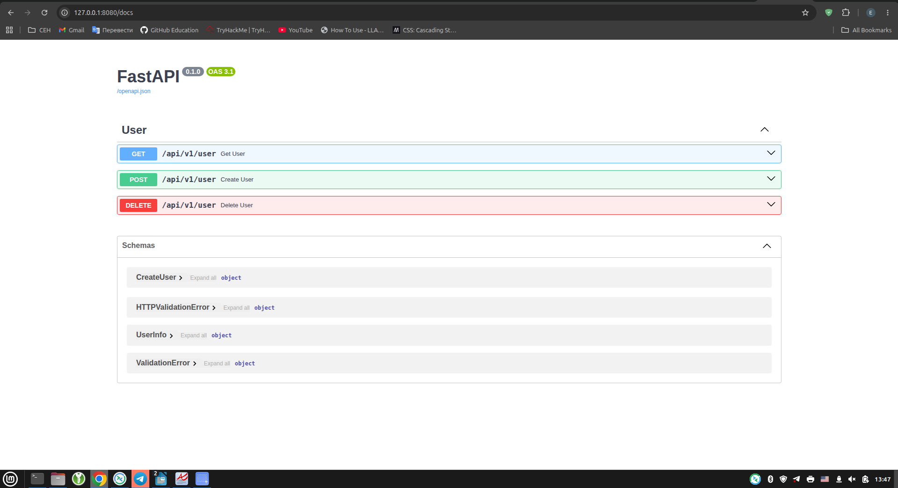


*Рисунок 15 – Проверка работы приложения через Swagger UI*

## Исходный код программы

Ниже представлены ключевые фрагменты файлов, использованных при выполнении лабораторной работы: тесты пользовательского API и workflow-файлы GitHub Actions для этапов CI и CD.

*Листинг 1 – Фрагмент файла tests/test_user.py*

```python
from fastapi.testclient import TestClient
from src.main import app

client = TestClient(app)

users = [
    {
        'id': 1,
        'name': 'Ivan Ivanov',
        'email': 'i.i.ivanov@mail.com',
    },
    {
        'id': 2,
        'name': 'Petr Petrov',
        'email': 'p.p.petrov@mail.com',
    }
]


def test_get_existed_user():
    response = client.get('/api/v1/user', params={'email': users[0]['email']})
    assert response.status_code == 200
    assert response.json() == users[0]


def test_get_unexisted_user():
    response = client.get('/api/v1/user', params={'email': 'ghost@example.com'})
    assert response.status_code == 404
    assert response.json() == {'detail': 'User not found'}


def test_create_user_with_valid_email():
    payload = {'name': 'Test User', 'email': 'test@example.com'}
    response = client.post('/api/v1/user', json=payload)
    assert response.status_code == 201
    assert isinstance(response.json(), int)


def test_create_user_with_invalid_email():
    payload = {'name': 'Duplicate User', 'email': users[0]['email']}
    response = client.post('/api/v1/user', json=payload)
    assert response.status_code == 409


def test_delete_user():
    payload = {'name': 'Delete User', 'email': 'delete@example.com'}
    client.post('/api/v1/user', json=payload)
    response = client.delete('/api/v1/user', params={'email': payload['email']})
    assert response.status_code == 204
```

*Листинг 2 – Workflow-файл tests.yml*

```yaml
name: Test Python App

on:
  push:

jobs:
  ci:
    runs-on: ubuntu-latest
    steps:
      - name: Checkout repository
        uses: actions/checkout@v4

      - name: Setup Python
        uses: actions/setup-python@v5
        with:
          python-version: '3.12'

      - name: Install dependencies
        run: |
          python -m pip install --upgrade pip
          pip install -r requirements.txt pytest httpx

      - name: Run tests
        run: python -m pytest tests/
```

*Листинг 3 – Workflow-файл build-and-delivery.yml*

```yaml
name: Build and Delivery

on:
  workflow_run:
    workflows: ["Test Python App"]
    types:
      - completed
    branches:
      - main

jobs:
  cd:
    runs-on: ubuntu-latest
    if: ${{ github.event.workflow_run.conclusion == 'success' }}
    steps:
      - name: Checkout repository
        uses: actions/checkout@v4
        with:
          ref: main

      - name: Login to Docker Hub
        uses: docker/login-action@v3
        with:
          username: ${{ vars.DOCKERHUB_USERNAME }}
          password: ${{ secrets.DOCKERHUB_TOKEN }}

      - name: Build and push Docker image
        uses: docker/build-push-action@v6
        with:
          context: .
          push: true
          tags: ${{ vars.DOCKERHUB_USERNAME }}/my-app:latest
```

## Заключение

В результате выполнения лабораторной работы был настроен полный CI/CD-процесс для Python-приложения. Были реализованы тесты для FastAPI-маршрутов, выполнена локальная проверка через pytest, подготовлен Dockerfile, а также созданы workflow-файлы GitHub Actions. После успешного прохождения тестов приложение было собрано в Docker-образ и опубликовано в Docker Hub. Работоспособность опубликованного образа была подтверждена запуском контейнера и открытием Swagger UI.

## Контрольные вопросы

**1. Как CI/CD помогает в разработке?**

CI/CD автоматизирует повторяющиеся этапы разработки: сборку, тестирование и доставку приложения. Благодаря этому ошибки обнаруживаются сразу после отправки изменений в репозиторий, а разработчик быстрее получает обратную связь. Такой подход уменьшает количество ручных операций и делает выпуск новых версий более предсказуемым.

**2. К какому этапу CI/CD относится сборка десктопного приложения под Windows, macOS и Linux для его дальнейшего тестирования?**

Такая сборка относится к этапу Continuous Integration. На этом этапе проверяется, что внесённые изменения корректно интегрируются в проект, а приложение может быть собрано для нужных платформ перед дальнейшим тестированием.

**3. Что такое Continuous Delivery и Continuous Deploy?**

Continuous Delivery означает, что после успешной сборки и тестов приложение автоматически подготавливается к выпуску и может быть развёрнуто в нужной среде с минимальными ручными действиями. Continuous Deploy идёт дальше: изменения, прошедшие проверки, автоматически разворачиваются в целевой среде без дополнительного ручного подтверждения

