# Лабораторная работа №6. Ansible

[← К списку лабораторных](../../README.md)

## Цель работы

Получить практическое представление о работе с Ansible.

Разобрать, как в Ansible задаются инвентарь, переменные, роли и playbook-сценарии.

## Индивидуальное задание

1. Изучить методические материалы к лабораторной работе.

2. Подготовить окружение из трёх виртуальных машин Ubuntu.

3. Описать файл инвентаря hosts, создав группы staging_serves, prod_serves и

all_serves.

4. Описать переменные для группы all_serves.

5. Проверить доступность серверов через ad-hoc команду.

6. Написать Playbook для установки и запуска nginx.

## Ход работы

### 4.1 Подготовка окружения

Для лабораторной работы был собран стенд из трёх виртуальных машин с Ubuntu. Хостам были назначены имена node-1, node-2 и node-3. Работа выполнялась от имени пользователя nikitin. Перед настройкой Ansible на каждом узле была просмотрена сетевая конфигурация, чтобы определить адреса, которые затем использовались в файле inventory.

В ходе проверки были использованы следующие IP-адреса: node-1 — 192.168.136.136, node-2 — 192.168.136.128, node-3 — 192.168.136.135. Такое распределение позволило обращаться как к отдельным машинам, так и объединять их в логические группы для дальнейшего управления через Ansible.

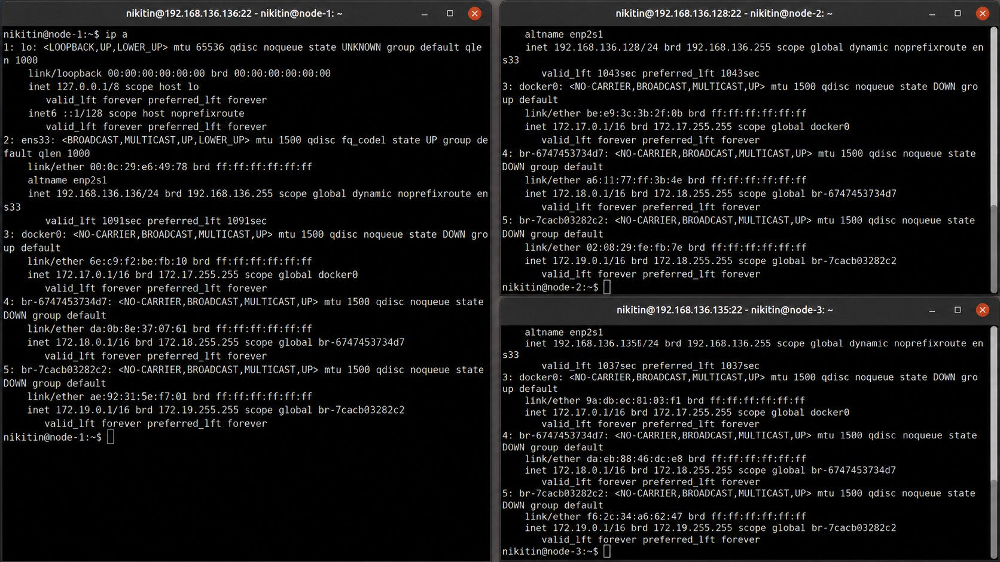

Рис. 1 – Проверка IP-адресов и сетевых интерфейсов на node-1, node-2 и node-3

На управляющей машине node-1 были установлены необходимые пакеты: ansible, sshpass, tree и curl. Ansible применялся для централизованного выполнения задач на удалённых узлах, sshpass обеспечивал подключение по паролю, tree использовался для просмотра структуры каталогов, а curl потребовался на этапе проверки работы веб-сервера nginx.

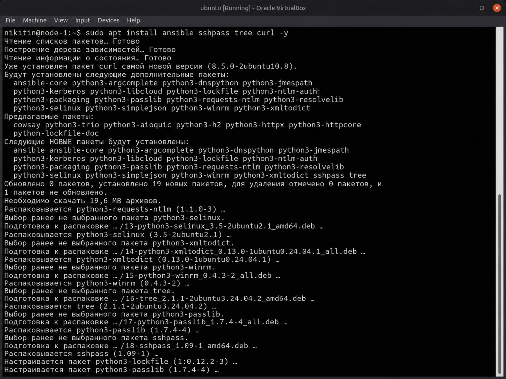

Рис. 2 – Установка Ansible и вспомогательных пакетов на управляющем узле node-1

Затем была проведена проверка установленного программного обеспечения. Вывод ansible --version подтвердил доступность Ansible в системе, а команды для sshpass и tree показали, что дополнительные утилиты также установлены и готовы к использованию.

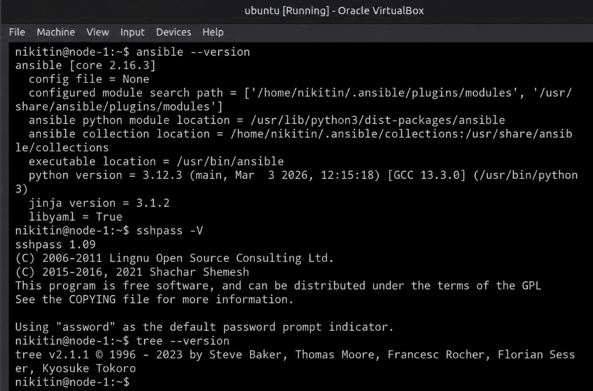

Рис. 3 – Проверка установленных версий Ansible, sshpass и tree

Отдельно была проверена возможность SSH-доступа к виртуальным машинам. При первом подключении система предложила добавить ключи хостов в файл known_hosts. После подтверждения подключение к узлам выполнялось корректно от пользователя nikitin.

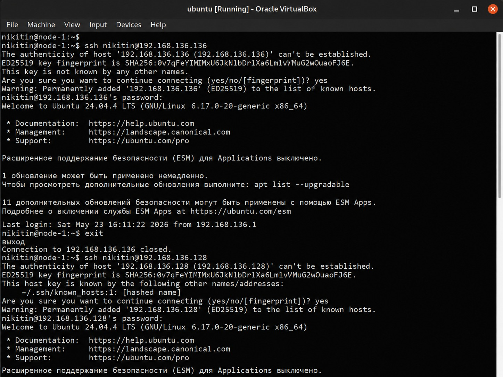

Рис. 4 – Проверка SSH-подключения от управляющего узла к виртуальным машинам

### 4.2 Создание инвентаря

На управляющем узле была создана директория ~/ansible, в которой размещались файлы лабораторного проекта. Внутри неё были подготовлены каталоги group_vars, roles/nginx/tasks и roles/nginx/handlers. Такое разделение позволяет хранить переменные, задачи роли и обработчики в разных частях проекта.

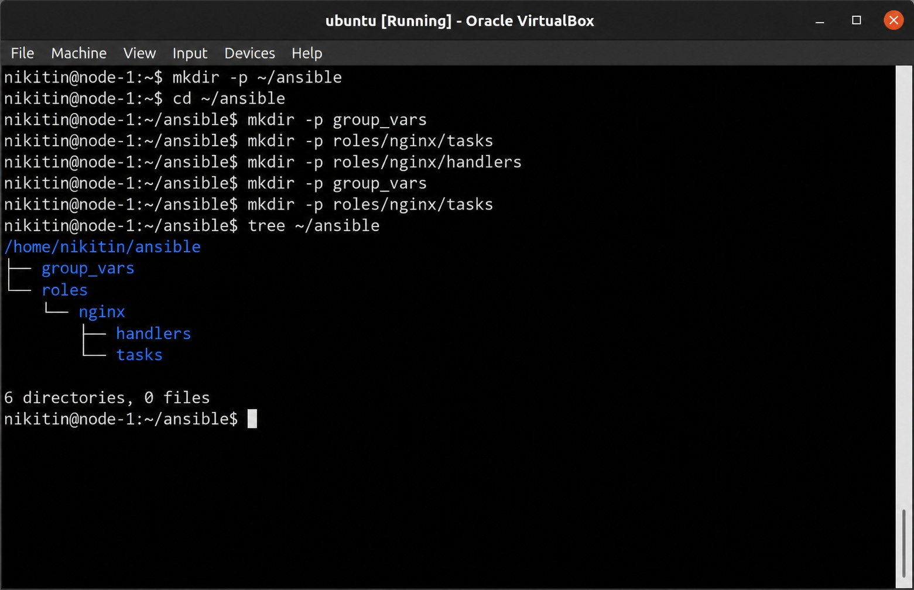

Рис. 5 – Создание рабочей директории Ansible и начальной структуры каталогов

После создания структуры были заполнены основные файлы: ansible.cfg, hosts и group_vars/all_serves.yml. В inventory узлы node-1 и node-2 были помещены в группу staging_serves, а node-3 — в группу prod_serves. Для совместного управления обе группы были включены в родительскую группу all_serves.

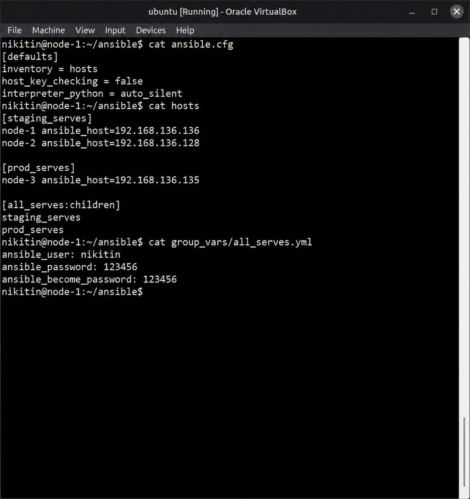

Рис. 6 – Содержимое файлов ansible.cfg, hosts и group_vars/all_serves.yml

Файл hosts был дополнительно проверен через команды ansible-inventory --list и ansible-inventory --graph. По выводу видно, что Ansible корректно распознал все группы и привязал к ним нужные хосты.

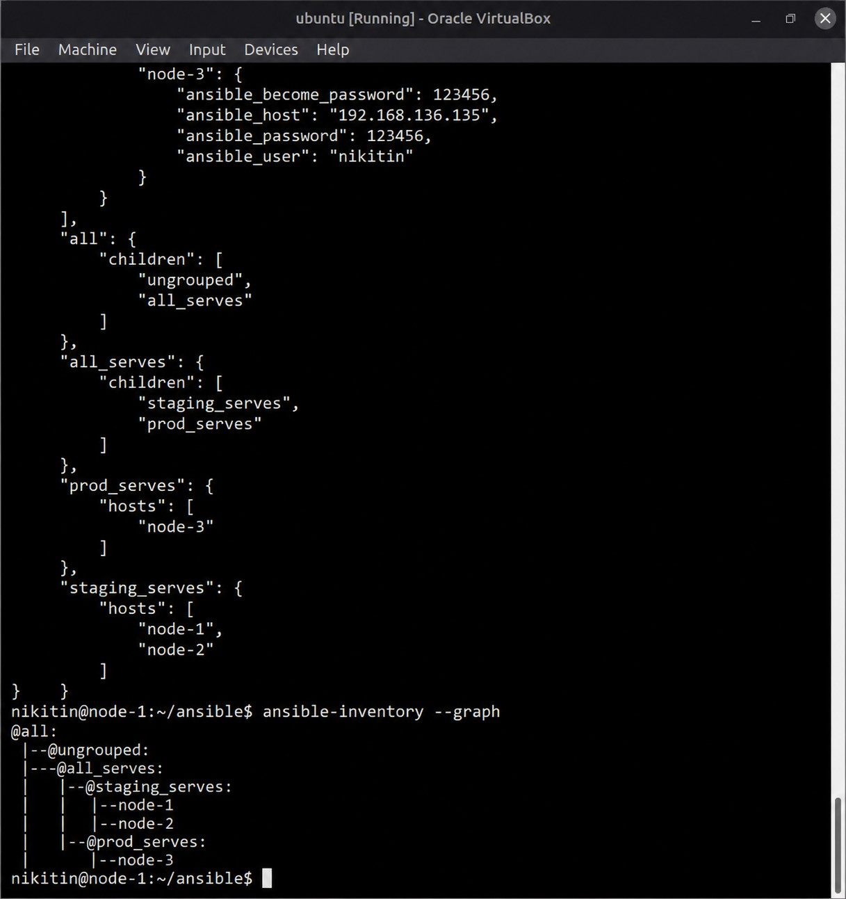

Рис. 7 – Проверка структуры inventory и групп узлов через ansible-inventory

### 4.3 Создание переменных группы

Для группы all_serves были заданы общие параметры подключения. В переменных указан пользователь nikitin, пароль для SSH и пароль для выполнения команд с повышенными правами. Для учебного стенда такой вариант удобен, поскольку позволяет быстро проверить работу Ansible без предварительной настройки ключевой авторизации.

```yaml
ansible_user: nikitin
ansible_password: 123456
ansible_become_password: 123456
```

Листинг 1 – Переменные группы all_serves для подключения к узлам

### 4.4 Проверка доступности хостов

После подготовки inventory была запущена ad-hoc команда ansible all_serves -m ping. Каждый из трёх узлов вернул ответ pong. Это означает, что SSH-подключение настроено верно, хосты доступны по сети, а inventory описан без ошибок.

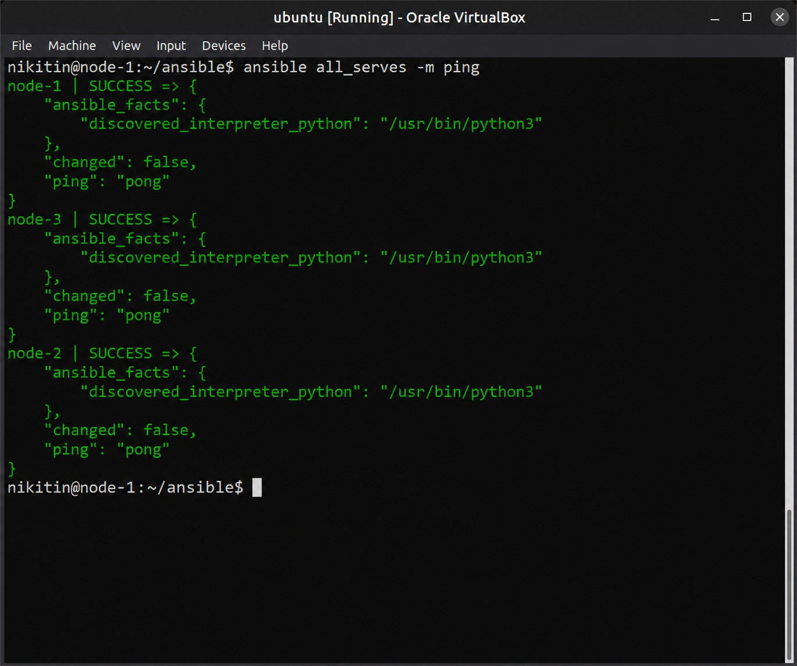

Рис. 8 – Успешная проверка доступности всех узлов командой ansible all_serves -m ping

### 4.5 Создание playbook и роли nginx

Для автоматической установки nginx была создана отдельная роль. В файле tasks/main.yml описаны обновление кэша apt и установка актуальной версии пакета nginx. В файле handlers/main.yml добавлен обработчик, который запускает службу nginx и включает её автозапуск через systemd. Основной playbook nginx_install_and_run.yml применяет роль ко всем узлам группы all_serves с повышением прав до root.

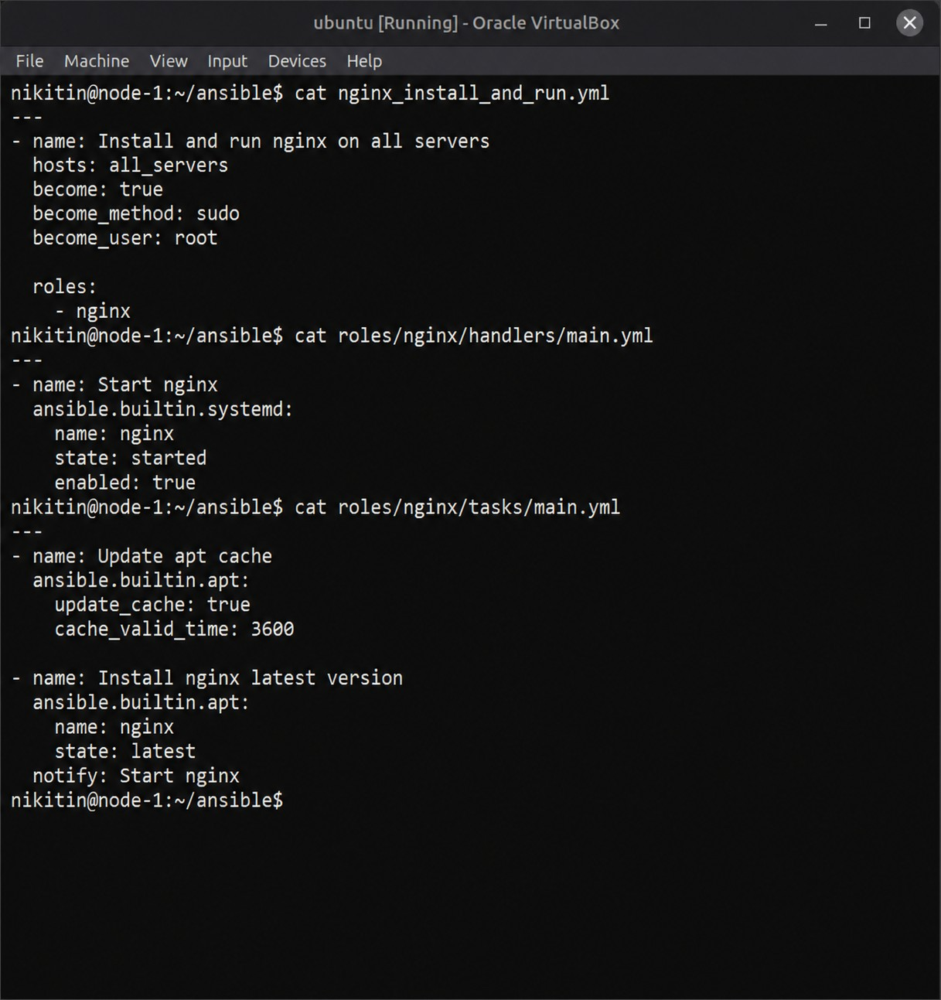

Рис. 9 – Содержимое playbook, обработчика и задач роли nginx

После добавления playbook и файлов роли была ещё раз просмотрена структура каталога проекта. На данном этапе в рабочей директории уже находились конфигурационный файл Ansible, inventory, групповые переменные, playbook и роль nginx с каталогами tasks и handlers.

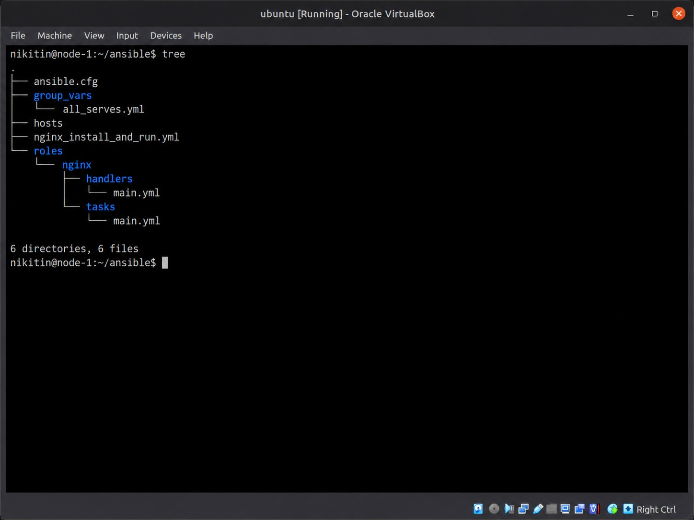

Рис. 10 – Итоговая структура Ansible-проекта перед запуском playbook

### 4.6 Запуск playbook и проверка выполнения

Когда все файлы были подготовлены, был выполнен запуск playbook nginx_install_and_run.yml. Ansible последовательно собрал факты с хостов, обновил кэш пакетов, установил nginx и вызвал обработчик запуска сервиса. В блоке PLAY RECAP по всем трём узлам отсутствовали ошибки, поэтому выполнение сценария можно считать успешным.

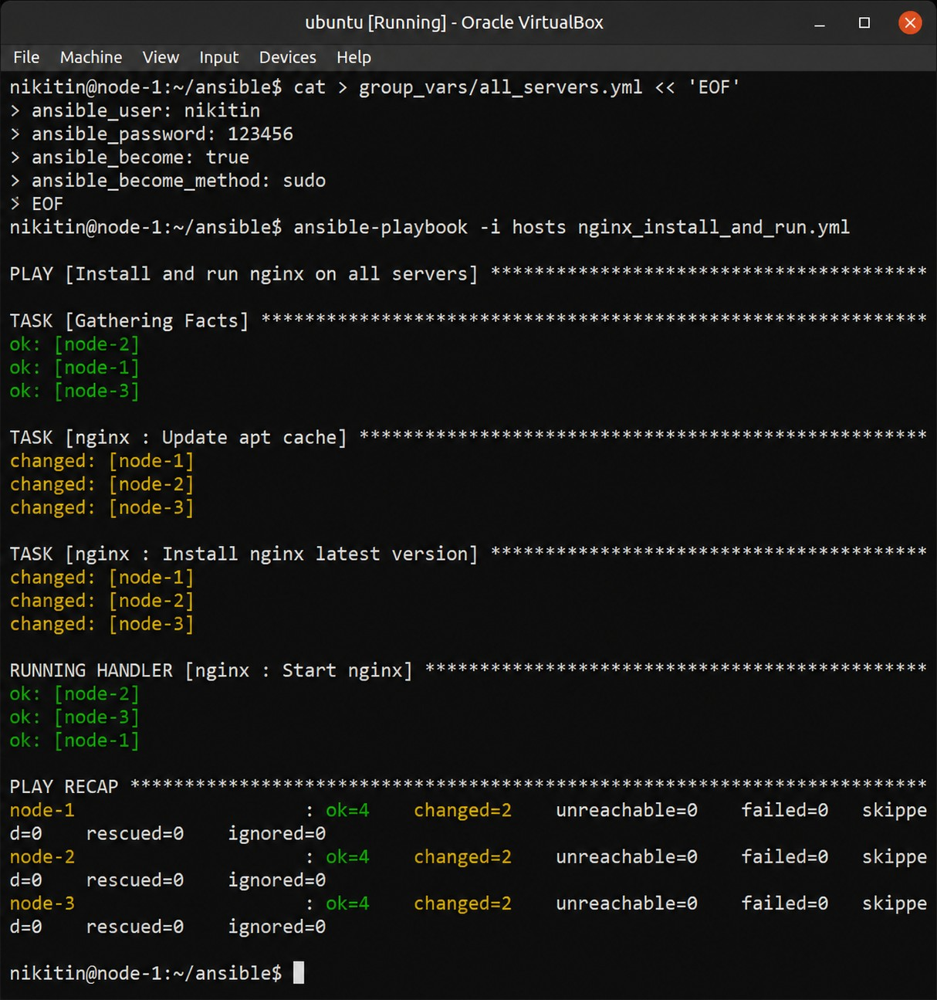

Рис. 11 – Успешный запуск playbook и установка nginx на всех трёх узлах

Финальная проверка была выполнена с помощью curl с управляющего узла. Для каждого из трёх IP-адресов был получен ответ HTTP/1.1 200 OK, а заголовок Server содержал nginx. Это подтверждает, что веб-сервер установлен, запущен и доступен по сети на всех виртуальных машинах.

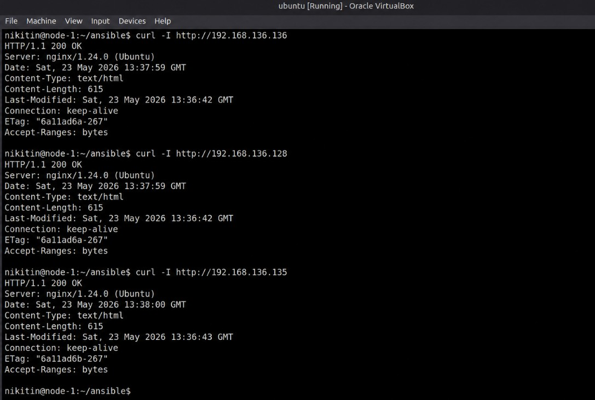

Рис. 12 – Проверка доступности nginx по HTTP через curl

Дополнительно результат был проверен в браузере. При обращении к адресам узлов открывалась стандартная страница Welcome to nginx!, что стало дополнительным подтверждением правильной установки и запуска сервиса.

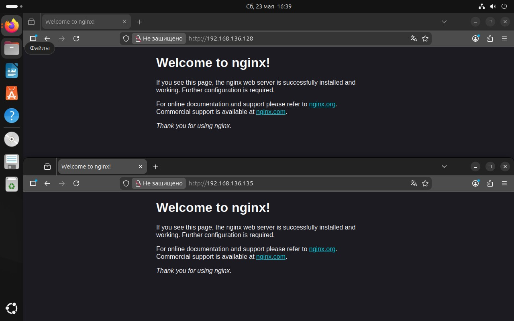

Рис. 13 – Проверка приветственной страницы nginx в браузере

## Вывод

В ходе лабораторной работы был подготовлен стенд из трёх виртуальных машин Ubuntu, проверена сеть и настроен SSH-доступ. На управляющем узле установлен Ansible, создан inventory с группами staging_serves, prod_serves и all_serves, а также задан файл групповых переменных.

Затем была создана роль nginx и playbook для установки и запуска веб-сервера. Успешное выполнение playbook, ответы ping, проверка через curl и открытие страницы nginx в браузере подтвердили корректность настройки.

## Контрольные вопросы

1. Что такое Ansible?

Ansible — это инструмент автоматизации администрирования и управления конфигурациями. Он позволяет выполнять команды и приводить удалённые серверы к заданному состоянию через SSH без установки агента на управляемые узлы.

2. Что такое Playbook?

Playbook — YAML-файл со сценарием для Ansible. В нём указываются хосты, задачи, роли, переменные и параметры выполнения, что позволяет повторяемо настраивать разные серверы.

3. Для чего нужны роли?

Роли нужны для структурирования проекта. Они разделяют задачи, обработчики, переменные, файлы и шаблоны по стандартным каталогам, поэтому одну настройку проще переносить между playbook.

4. Что гарантирует идемпотентность в Ansible?

Идемпотентность означает, что повторный запуск задачи не создаёт лишних изменений, если нужное состояние уже достигнуто. Например, установленный и запущенный nginx Ansible не будет переустанавливать без необходимости, а просто подтвердит текущее состояние.